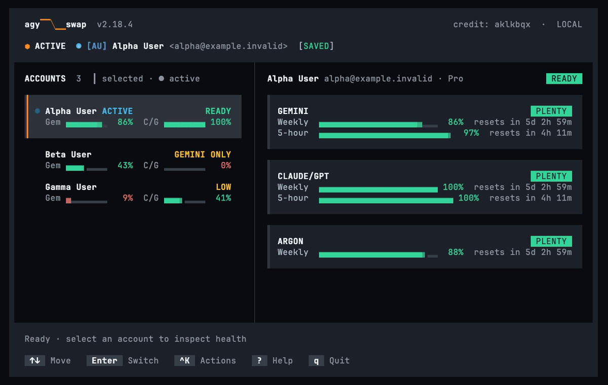

<div align="center">

# agy-swap

### Switch Google Antigravity accounts in the CLI and the IDE from one terminal

[](https://github.com/aklkbqx/agy-swap/releases)
[](https://agy-swap.aklkbqx.com)
[](LICENSE)
[](https://github.com/aklkbqx/agy-swap/releases)
[](https://github.com/aklkbqx/agy-swap/releases)

<br/>

<a href="https://agy-swap.aklkbqx.com/#showcase">
  
</a>

</div>

agy-swap keeps several Google Antigravity accounts on one machine. It shows how much quota each account has left and when it resets. Pick one and agy-swap switches the `agy` CLI and, on macOS and Linux, the Antigravity IDE to that account. Everything runs on your machine. Saved tokens stay in `vault.json`, which only your user can read, or in your OS credential store with `AGY_SWAP_VAULT=keychain`.

## Install

Shell and PowerShell installers verify downloaded release binaries against SHA-256 checksums. Go builds use the Go module toolchain.

macOS and Linux:

```bash
curl -fsSL --proto '=https' --tlsv1.2 https://raw.githubusercontent.com/aklkbqx/agy-swap/main/install.sh | bash
```

Windows (PowerShell):

```powershell
irm https://raw.githubusercontent.com/aklkbqx/agy-swap/main/install.ps1 | iex
```

With Go (the module requires Go 1.27.3; with the default `GOTOOLCHAIN=auto` an older go command downloads it first):

```bash
go install github.com/aklkbqx/agy-swap/v2/cmd/agy-swap@latest
```

`go install` builds with Go 1.27.3 or newer, the version that carries the standard-library security fixes. Published binaries use the same floor.

Pre-built binaries for `darwin/amd64`, `darwin/arm64`, `linux/amd64`, `linux/arm64`, `windows/amd64`, and `windows/arm64`, with checksums, are on [GitHub Releases](https://github.com/aklkbqx/agy-swap/releases). The [install page](https://agy-swap.aklkbqx.com/install.html) shows one command at a time for your operating system.

### Build from source

Requirements: Go 1.27.3 or later. macOS source builds require Xcode Command Line Tools and `CGO_ENABLED=1` for Keychain writes.

```bash
git clone https://github.com/aklkbqx/agy-swap.git
cd agy-swap
go build -trimpath -ldflags "-s -w -X main.version=2.22.1 -X main.buildID=local" -o agy-swap ./cmd/agy-swap
./agy-swap version
```

### On a restricted network

Some company networks inspect TLS (Zscaler, Fortinet, Netskope and similar), block GitHub downloads, or answer DNS with a blocking address. The shell installer and `agy-swap update` can work around all three. The PowerShell installer supports the mirror and `AGY_SWAP_INSECURE` only.

Trust your company's root certificate. This is the safest option:

```bash
curl -fsSL --cacert /path/to/company-ca.pem https://raw.githubusercontent.com/aklkbqx/agy-swap/main/install.sh \
  | AGY_SWAP_CA_BUNDLE=/path/to/company-ca.pem bash
```

`agy-swap update` reads the same `AGY_SWAP_CA_BUNDLE` (or `CURL_CA_BUNDLE`).

Download from a mirror of the release files when GitHub downloads are blocked:

```bash
AGY_SWAP_RELEASE_MIRROR=https://mirror.example.com/agy-swap bash install.sh
```

The installers download from the mirror instead of GitHub and expect the files at its top level. `agy-swap update` tries GitHub first, then a `vX.Y.Z/` folder on the mirror, then its top level.

When a TLS error suggests the local DNS answer was redirected, agy-swap looks the host up again over DNS-over-HTTPS (Cloudflare `1.1.1.1`, then Google `8.8.8.8`) and ignores answers that point to private addresses. The shell installer retries a failed download once with curl's `--doh-url` (Cloudflare by default). Set `AGY_SWAP_DOH_URL` to use your own resolver.

If a TLS certificate error blocks the download, `agy-swap update` builds the release with `go install` instead. This needs Go on your PATH and does not run on Windows. Go checks the source against its checksum database, but the binary is not compared with the release checksum. Set `AGY_SWAP_NO_GO_FALLBACK=1` to turn it off, or `AGY_SWAP_GO_FALLBACK=1` to use it after any download error.

As a last resort the shell installer can skip certificate checks with `AGY_SWAP_INSECURE=1`. It still checks the SHA-256 checksum, but anyone on the network path could swap both files. Prefer the certificate bundle. You can also use `go install` or build from source as shown above.

## First run

1. If you do not have the Google Antigravity CLI (`agy`) installed yet, run `agy-swap install-agy` (or let `agy-swap add` offer to install it for you).
2. Run `agy-swap add` and complete the browser sign-in to save an account.
3. Run `agy-swap` to open the terminal view. Check the active account and quota snapshot before switching.
4. Select an account, press Enter and choose Switch. The `agy` CLI uses the new account from its next run. On macOS and Linux the Antigravity IDE switches too (see below). Other programs that are already running may need a restart.

## Switch the CLI and the IDE together

One switch moves every Antigravity surface on this machine to the same account: the `agy` CLI, the Antigravity IDE (macOS and Linux) and Jetski. You do not sign out of the IDE or open a browser.

What agy-swap changes to make this work:

- It writes the account's session to the files the CLI, the IDE and Jetski read under `~/.gemini`, and copies it into the system keychain, which the IDE also reads. On macOS this uses `/usr/bin/security`; on Linux it uses `secret-tool` when it is installed.
- It updates the signed-in account name the IDE shows, in the IDE's `state.vscdb`, when `sqlite3` is installed.
- It wraps `~/.local/bin/agy` and `~/.gemini/bin/agy` (and an `agy` you set with `AGY_SWAP_AGY_BIN` or `install-agy --dir`) in a small shell script that runs `agy-swap --sync-session` before and after each `agy` run. The original binary moves to `~/.local/libexec/agy` for the default CLI install and to `.agy.real` in the same folder for the others. If `agy` is a symlink, the wrapper calls the file it points to and nothing is moved.
- The IDE checks `agy` against the size and modification time recorded in `agy.version.json` next to it. agy-swap writes the wrapper's size and time into that file so the IDE keeps using the wrapper. The recorded version and checksum stay as they were.
- After a switch it records the switch in `~/.gemini/antigravity-cli/cache/agy-swap-hub-reload` and stops the IDE's background `agy` service with `pkill`. The wrapper sees the new record and starts the service again with the new account, so you do not restart the IDE. Work an agent is doing in the IDE at that moment stops.

If a token is refreshed in the CLI or the IDE, agy-swap saves the fresh copy to the right account the next time it runs.

If the IDE or `agy` is signed in to an account you have not saved in agy-swap, agy-swap leaves that session alone; `agy-swap add` offers to save it. After you sign out and no session file is left, agy-swap does not write one back. Choose an account in agy-swap to sign in again.

agy-swap puts the wrapper back each time it runs. To remove it, uninstall agy-swap first, then move the original binary back over `agy` (or reinstall `agy`). Windows does not get IDE switching yet; switching there updates the CLI session only.

## Using the terminal UI

Run `agy-swap` with no arguments to open the terminal UI:

```bash
agy-swap
```

Each account shows a status word and two meters: Gem (Gemini) and C/G (Claude and GPT). When Google gives an account a separate weekly Gemini 4 Argon pool (Pro plans), it gets its own gauge panel, and a used-up Argon pool does not change the status word. The status word says what the account can be used for right now: `READY`, `LOW` (a pool is at 30% or less), `GEMINI ONLY` or `CLAUDE/GPT ONLY` (the other pool is used up), `LIMITED` (both are used up), `NO TOKEN`, or `VERIFY` (Google wants the account verified before Antigravity can use it). Each meter shows the tighter of that pool's weekly and 5-hour limit. The selected account gets a gauge panel per pool with both limits, when each resets, and, for a used-up pool, when it is back. Green means more than 30% is left, yellow 30% or less, red 10% or less; every state also has a word.

The layout follows your terminal size:

- Wide (92 columns or more): the account list on the left, the gauges on the right. Below 120 columns each pool panel puts its percentage beside the bars; from 120 columns the pool panels sit side by side, two to a row, with large percentages when there are enough rows. The dashboard stops growing at 160 columns and stays centred on a wider terminal.
- Stacked (64 to 91 columns): the list on top, the gauges below.
- Compact (41 to 63 columns) and narrow (40 or fewer): one column, with the selected account's pools below the list.

A terminal cannot change its font, so on a large window the dashboard draws bigger instead, up to 160 columns: big digits grow up to twice their size and bars become full blocks. With too few rows for big digits, gauges become plain limit lines, down to a 28 by 12 window. Changes move briefly: the selection slides, meters ease and dialogs open from their centre.

Quota stays close to live without you pressing anything:

- The account Antigravity is using is read every 20 seconds, the others every 2 minutes, and any account right after its pool resets.
- When Antigravity writes to its logs, quota is read again within about 10 seconds. agy-swap only looks at the log files' sizes and times.
- Each account's Code Assist project is remembered for 15 minutes, so most reads are one request.
- An account that Google refuses (HTTP 429 or 5xx) is read less often until it recovers.
- Another agy-swap process changing the accounts makes this one reload. Reset times are corrected when this machine's clock is off.

Settings:

| Variable | Effect |
| :--- | :--- |
| `AGY_SWAP_REDUCED_MOTION=1` | Turn off motion |
| `AGY_SWAP_ASCII=1` / `0` | Force ASCII drawing on or off (on by default for a Linux console, a dumb terminal or a non-UTF-8 locale) |
| `AGY_SWAP_QUOTA_DEBUG=1` | With `agy-swap list --refresh`, explain how each account's quota was read |
| `AGY_SWAP_USER_AGENT` | Override the client string sent to Google if a future Antigravity release makes quota pools disappear |

| Key | Action |
| :--- | :--- |
| `↑` / `↓` or `j` / `k` | Move the highlight up or down |
| `[` / `]` or `<` / `>` | Narrow or widen the account pane (side by side), or shorten or lengthen the account list (stacked) |
| `=` | Reset the pane split |
| Mouse | Hover shows what a click does. Click an account to select it and again to switch; click a key hint in the footer to press it, a dialog button to choose it, a palette row to run it, or beside a dialog to close it. Drag the divider (side by side) or the rule (stacked) to resize the list, double-click it to reset. The wheel scrolls a list or panel that does not fit (drag its bar, or click above or below the thumb to page) and otherwise moves the selection. `AGY_SWAP_MOUSE=0` turns the mouse off; kitty, foot, Ghostty and WezTerm also show a hand or resize pointer |
| `Enter` | Switch to the highlighted account (asks first) |
| `1` – `9` | Select an account by number; press Enter to switch |
| `←` / `→` and `Enter` in a dialog | Choose a button and press it; `y` / `n` are shortcuts, `Esc` cancels |
| `n` | Refresh and move to the next eligible account |
| `/` | Filter accounts by name or email |
| `Ctrl-K` or `:` | Open the command palette |
| `r` | Refresh every account's quota now |
| `w` | Open Google's verification page for an account marked `VERIFY` |
| `p` / `h` / `s` | Open Profiles, History, or Settings |
| `o` / `b` | Open Doctor or Backup |
| `a` | Add a Google account through the browser sign-in |
| `d` / `Delete` | Remove the account from the local store, after confirmation |
| `e` | Edit tags, aliases, or the selected item |
| `m` | Move legacy tokens from accounts.json into the vault |
| `u` | Update agy-swap to the latest release, checking its checksum |
| `?` | Show or hide the shortcut list |
| `q` / `Esc` | Close an overlay or quit |

## Commands

Every TUI action is also a command, so you can script it.

| Command | What it does |
| :--- | :--- |
| `add` | Sign in with Google and save the account |
| `list` | List saved accounts with status and quota health |
| `switch` | Switch the local session to an account by email, alias, or number |
| `next` | Refresh, then switch to the next account with quota left |
| `status` | Show the active account |
| `limits` | Show quota for every account |
| `verify` | Open Google's verification page for an account that needs it |
| `profile` / `bind` | Define profiles and bind directories to them |
| `recommend` | Explain which account is safest to use now |
| `run now` | Launch the configured CLI with the right account |
| `install-agy` | Download and install the Google Antigravity CLI (`agy`), checking its SHA-512 checksum |
| `doctor` | Check storage, credentials, vault, and platform readiness |
| `statusline` | Render or install a statusline for your prompt |
| `backup` | Export or import accounts |
| `update` | Update agy-swap to the latest release |
| `donate` | Show the GitHub Sponsors support link (or open it with `--open`) |

### Accounts and switching

```bash
# Add an account through the browser sign-in
agy-swap add

# Add an account from a token on stdin (for scripts)
printf '%s' "$TOKEN" | agy-swap add --token -

# List saved accounts with status and quota
agy-swap list
agy-swap list --verbose

# Switch by email or by list number
agy-swap switch dev@company.com
agy-swap switch 2

# Move to the next account with quota left
agy-swap next

# Only consider one model family: claude, gemini, gpt or argon
agy-swap next --family claude

# Show the active account
agy-swap status

# Sign out of the active session
agy-swap logout
```

`list` keeps accounts in their saved order, so numeric slots match `switch`.
Quota pools use compact `Weekly` and `5-Hour` rows with aligned percentages.
Each valid reset time shows both the countdown and a local date/time with its
UTC offset, for example `resets in 2d 19h 6m (Fri 16 Oct 14:06 +0700)`.
When a saved reset time has passed, the row says `refresh due` and retains that
timestamp; refresh quota before relying on the old data.

### Quota and cooldowns

```bash
# Show quota for every account
agy-swap limits

# Read quota from Google now and show every pool
agy-swap limits --refresh --verbose

# Set or clear a cooldown by hand
agy-swap limit set 1 6h --group claude
agy-swap limit set dev@company.com reset --group claude
```

### Profiles, aliases, and project bindings

```bash
# Give accounts short names
agy-swap alias set work dev@company.com
agy-swap alias set personal user@example.com

# Create a profile
agy-swap profile set work-profile work --family gemini

# Set a primary account, a reserve and a ranking policy
agy-swap profile set work-profile work --family gemini --policy sticky --reserve personal --threshold 15

# Bind a directory to an existing profile
agy-swap bind set /path/to/my-repo work-profile --mode recommend

# Recommend for that profile, or resolve the working directory when running
agy-swap recommend --profile work-profile --refresh
agy-swap run now
```

### Diagnostics, statusline, and metrics

```bash
# Check storage, credentials and platform setup
agy-swap doctor

# Add agy-swap to a Starship, tmux or zsh statusline
agy-swap statusline install
agy-swap statusline render < statusline.json

# Print a local Prometheus-compatible metrics snapshot (no HTTP server)
agy-swap metrics prometheus

# Install or update the Google Antigravity CLI (optionally into a custom directory)
agy-swap install-agy
agy-swap install-agy --dir ~/.local/custom-bin

# Check the session, then start agy
agy-swap run now
agy-swap run now --account dev@company.com -- -p "Audit codebase"
```

### Backups and credential migration

```bash
# Move legacy plaintext tokens from accounts.json into the vault
agy-swap account migrate --force

# Export accounts without secrets
agy-swap backup export --output agy-swap-backup.json

# Export everything, secrets encrypted with a passphrase
printf '%s' "$BACKUP_PASSPHRASE" | agy-swap backup export --include-secrets --passphrase-stdin --output agy-secrets.json

# Import a backup and merge it
agy-swap backup import agy-swap-backup.json --merge
```

## Walkthrough

The clips below use fictional `@example.invalid` accounts. Regenerate them with `make media` (needs [VHS](https://github.com/charmbracelet/vhs)).

### Switch accounts
Run `agy-swap` to open the operator deck. Move through saved accounts with `↑`/`↓`, compare the weekly and 5-hour quota for each model family, then press `Enter` and confirm to switch the shared Antigravity session.

<p align="center">
  
</p>

### Keyboard guide and action palette
Press `?` for the keyboard guide. Press `Ctrl+K` (or `:`) to open the action palette and type to filter actions.

<p align="center">
  
</p>

### Commands for scripts
The same work runs without the TUI:

```bash
# List accounts with tier and quota
agy-swap list

# Show the active account
agy-swap status

# Rank accounts for the current policy
agy-swap recommend

# Switch to a named account
agy-swap switch beta@example.invalid
```

<p align="center">
  
</p>

## How account selection works

`recommend` ranks eligible accounts first. Eligibility requires a quota snapshot no older than two minutes, positive remaining capacity at or above the policy reserve, and no matching manual or log cooldown. Without `--family`, the tighter of the shared Gemini and Claude/GPT pools governs readiness; the Argon pool counts only with `--family argon`. When an account has no Argon pool of its own (Ultra counts Argon against the Gemini pool), `--family argon` reads the Gemini pool. `recommend --apply`, `next`, and bound runs refresh before selecting; failed refreshes cannot authorize a switch. Use `switch ACCOUNT` for an explicit override.

`sticky` prefers the active account (or profile primary), `balanced` favors remaining capacity, and `round-robin` advances through saved order. Profile reserves are fallback candidates when the primary is unavailable. `next` advances rotation even with sticky policy and, under any policy, leaves the active account whenever another account is eligible (balanced picks the one with the most quota). `watch --account` limits polling to that account; `watch --profile` uses its primary and notification threshold.

Bindings take effect in `run now`, not when a shell merely changes directory. `--account` overrides a binding. Recommend mode prints a suggestion, prompt mode asks in a terminal, and auto mode requires `policy.allow_apply=true`. These profiles update one shared local Antigravity session; they do not isolate simultaneous processes. Targets launch executables and do not translate Google credentials into credentials for other providers.

## Security and privacy

Saved account tokens are stored in `vault.json` in the agy-swap config directory, readable only by your user (`0600`). The file is not encrypted. Set `AGY_SWAP_VAULT=keychain` to keep them in the OS credential store instead ([macOS Keychain](https://support.apple.com/guide/security/keychain-data-protection-secb0694df1a/web), [Windows Credential Manager](https://learn.microsoft.com/en-us/windows/win32/secauthn/credentials-management), or [Linux Secret Service](https://specifications.freedesktop.org/secret-service/)); `AGY_SWAP_VAULT=file` uses the file only. `agy-swap doctor` shows which one is in use.

Switching writes the active session where Antigravity reads it: OAuth files under `~/.gemini` (mode `0600`) and, on macOS and Linux, the system keychain. On macOS the keychain write runs `/usr/bin/security`, and the token is passed in its command arguments, where other processes of your user can see it while it runs. In keychain mode the saved-account vault uses Security.framework instead. `AGY_SWAP_VAULT` picks where saved accounts live, not where the active session goes. Old vault references may remain so local backups can still be restored.

If the selected vault cannot be written, the saved token stays as plaintext `token_data` in `accounts.json` (`0600`). Doctor reports `vault_migration`; run `agy-swap account migrate --force` again when the vault works.

`agy-swap doctor` checks local storage, credentials and platform setup. It may create the config directory or tighten its permissions, and it recovers an interrupted backup restore while loading state, so it is not strictly read-only. `doctor --refresh` also checks GitHub release information for your platform's download.

Adding an account requires a verified email from Google's userinfo endpoint. Decoded JWT claims are only used as local hints; their signatures are not checked.

Metadata exports leave out secrets and machine-local vault references. When merging, an existing credential is kept if the backup has none. Secret exports use AES-GCM with PBKDF2-HMAC-SHA256 (600,000 iterations); older encrypted backups can still be read. Verify and import use the same checks. Imports keep a recovery journal; do not delete it after an interrupted restore.

Switch and quota history is kept as local JSONL records with locking and retention. It is not a tamper-proof audit log.

Configuration writes take an advisory file lock (`flock` on Unix, `LockFileEx` on Windows), write to a temporary file and then rename it.

OAuth tokens are removed from CLI logs and terminal output. Tokens can be passed on stdin.

agy-swap sends no telemetry. It talks to Google for sign-in, token refresh and quota; to GitHub for releases and updates; to agy-swap.aklkbqx.com for the latest version when GitHub is unreachable; and, after a TLS failure, to DNS-over-HTTPS resolvers (`1.1.1.1`, `8.8.8.8`, or `AGY_SWAP_DOH_URL`). Only when you use them does it also contact a release mirror you set, Go's module proxy and checksum database for the `go install` fallback, and Google's download server for `install-agy`.

TLS certificates are always checked unless you turn that off. Prefer `AGY_SWAP_CA_BUNDLE` with your company's certificate; `AGY_SWAP_INSECURE=1` (installer) and `AGY_SWAP_INSECURE_TLS=1` (the binary) turn certificate checks off entirely.

To report a vulnerability, see [SECURITY.md](SECURITY.md).

## Contributing

See [CONTRIBUTING.md](CONTRIBUTING.md), [docs/development.md](docs/development.md) for build and test commands, and [docs/architecture.md](docs/architecture.md) for how the code is organized.

## Support

If agy-swap saves you time, you can support maintenance through [GitHub Sponsors](https://github.com/sponsors/aklkbqx), or run `agy-swap donate --open`.

## License

Distributed under the MIT License. See [LICENSE](LICENSE).
