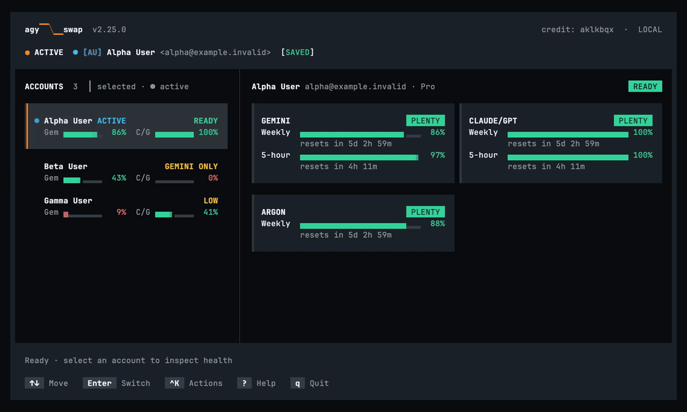
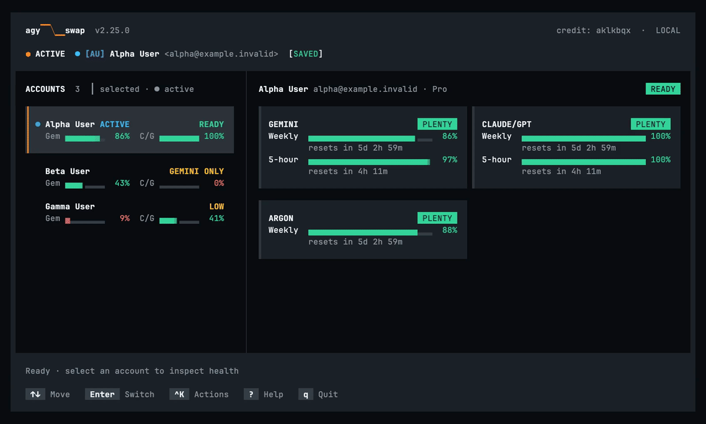

# agy-swap

Switch Google Antigravity accounts from your terminal without signing out in a browser.

Check 5-hour and weekly quota for Gemini, Claude/GPT, and Gemini 4 Argon, then press `Enter` to switch both the `agy` CLI and the Antigravity IDE (macOS and Linux; CLI only on Windows).

[](https://github.com/aklkbqx/agy-swap/releases)
[](LICENSE)
[](https://agy-swap.aklkbqx.com)

[Website](https://agy-swap.aklkbqx.com) · [Guides](https://agy-swap.aklkbqx.com/guides/) · [Reference](docs/reference.md) · [ไทย](docs/i18n/README.th.md) · [日本語](docs/i18n/README.ja.md) · [简体中文](docs/i18n/README.zh-CN.md) · [한국어](docs/i18n/README.ko.md)



## What it does

- Switches the `agy` CLI and, on macOS and Linux, the Antigravity IDE and Jetski in place without browser sign-out.
- Tracks 5-hour and weekly `Gemini`, `Claude/GPT`, and Pro weekly `Gemini 4 Argon` quota with local reset countdowns and `READY`, `LOW`, `GEMINI ONLY`, `CLAUDE/GPT ONLY`, `LIMITED`, and `VERIFY` status badges.
- Keeps background `agy` token refreshes in other open terminals from overwriting your active account (`--sync-session`).
- Supports scripted rotation (`next --family claude`), cooldowns (`limit`), repo bindings (`profile` / `bind`), prompt `statusline` (Starship, tmux, zsh), AES-GCM encrypted `backup`, and SHA-512 verified `install-agy`.

## Install

```bash
# Homebrew (macOS and Linux)
brew install aklkbqx/agy-swap/agy-swap

# Shell (macOS and Linux, verifies SHA-256)
curl -fsSL --proto '=https' --tlsv1.2 https://agy-swap.aklkbqx.com/install.sh | bash
```

```powershell
# Windows PowerShell (verifies SHA-256)
irm https://agy-swap.aklkbqx.com/install.ps1 | iex
```

```bash
# Build from source (Go 1.27.4+)
go install github.com/aklkbqx/agy-swap/v2/cmd/agy-swap@latest
```

Behind a corporate TLS proxy or installing from an internal mirror? See [docs/reference.md](docs/reference.md#install-and-restricted-networks) or the [install page](https://agy-swap.aklkbqx.com/install.html).

## Quick start

```bash
agy-swap install-agy   # optional: install the official agy CLI
agy-swap add           # sign in with Google and save an account
agy-swap               # open the TUI, pick an account, press Enter -> Switch
```

## Demos and everyday usage

### TUI shortcuts and command palette

Use `↑`/`↓` or `1`-`9` to select an account, `Enter` to switch, `/` to filter, `r` to refresh quotas, `n` for the next eligible account, `w` to open a `VERIFY` link, `?` for all shortcuts, and `Ctrl+K` (or `:`) for the command palette.



### CLI commands for scripts

```bash
agy-swap list                          # saved accounts, status badges, and quota bars
agy-swap switch 2                      # switch by email, alias, or slot
agy-swap next --family claude          # refresh and rotate to next eligible account
agy-swap limits --refresh              # inspect 5-hour, weekly, and Argon windows
agy-swap limit set 1 6h --group claude # set or clear manual cooldowns
agy-swap verify dev@company.com        # open Google verification URL for VERIFY accounts
agy-swap statusline install            # add active account and quota to Starship, tmux, or zsh
agy-swap doctor                        # check vault, wrapper, and network readiness
```


For profiles, directory bindings, running two concurrent CLI sessions with isolated `HOME` (`AGY_SWAP_SKIP_SYNC=1`), env vars, and how the IDE wrapper works, see [docs/reference.md](docs/reference.md) and the [command reference](https://agy-swap.aklkbqx.com/commands/).

## Security and account safety

- Local session switcher, not an API router or OAuth proxy. Prompts and model inference never pass through `agy-swap`; every request still runs through the official `agy` CLI or Antigravity IDE.
- Switching updates local session files (`~/.gemini` and your OS keychain mirror) and polls quota from Google's endpoint. Google's own multi-account, billing, and acceptable-use rules still apply, so `agy-swap` cannot promise zero account risk.
- Saved tokens stay in `vault.json` (`0600`, not encrypted). Set `AGY_SWAP_VAULT=keychain` to store them in macOS Keychain, Windows Credential Manager, or Linux Secret Service instead.
- No usage telemetry or crash reports. Eligible interactive and networked commands run a cached daily `/version.json` check; disable it with `AGY_SWAP_NO_UPDATE_CHECK=1` or `DO_NOT_TRACK=1`.

Full security details, network endpoints, and vulnerability reporting live in [SECURITY.md](SECURITY.md) and [agy-swap.aklkbqx.com/security/](https://agy-swap.aklkbqx.com/security/).

## Guides

- [Quota limits, 5-hour windows, and Gemini 4 Argon](https://agy-swap.aklkbqx.com/guides/antigravity-quota-limits/)
- [Switch both the agy CLI and Antigravity IDE](https://agy-swap.aklkbqx.com/guides/switch-accounts-cli-ide/)
- [Directory bindings and parallel CLI sessions](https://agy-swap.aklkbqx.com/guides/parallel-sessions/)
- [Troubleshooting HTTP 429, Keychain, VERIFY, and corporate proxies](https://agy-swap.aklkbqx.com/guides/troubleshooting/)
- [Shell prompt statusline for Starship, tmux, and zsh](https://agy-swap.aklkbqx.com/guides/statusline-automation/)
- [Compare agy-swap with manual login and alternatives](https://agy-swap.aklkbqx.com/compare/)
- [Full CLI, TUI, and proxy reference](docs/reference.md)

## Contributing, support, and license

- Contribute via [CONTRIBUTING.md](CONTRIBUTING.md), [docs/development.md](docs/development.md), and [docs/architecture.md](docs/architecture.md).
- Optional support: [GitHub Sponsors](https://github.com/sponsors/aklkbqx) (or run `agy-swap donate --open`).
- MIT License by [Akalak Kruaboon](https://aklkbqx.com/). See [LICENSE](LICENSE).
