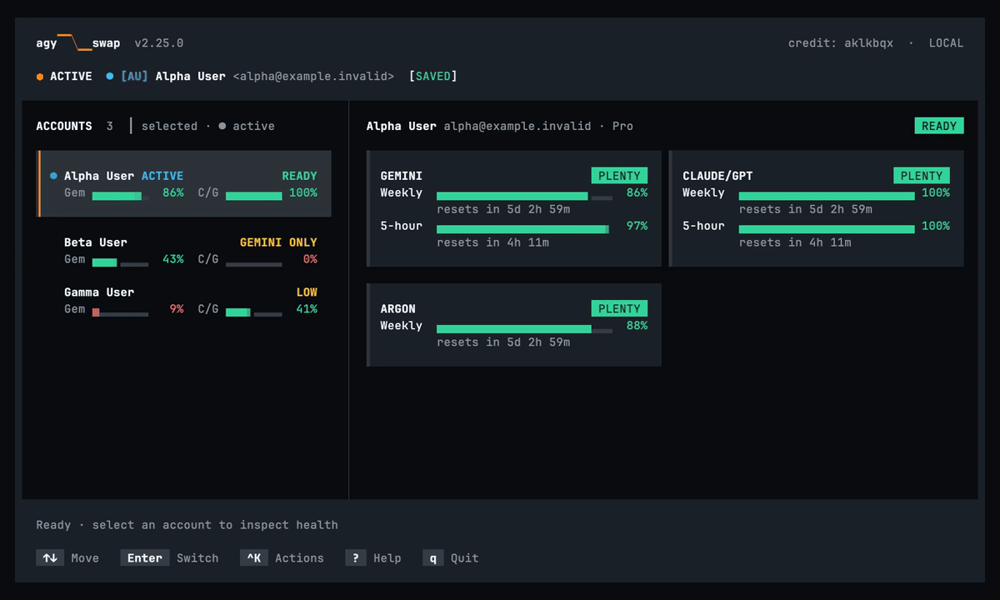

# agy-swap (日本語)

ブラウザーでサインアウトせずに、ターミナルから Google Antigravity のアカウントを切り替えます。

Gemini・Claude/GPT・Gemini 4 Argon の 5 時間枠と週間クォータを確認し、`Enter` を押すだけで `agy` CLI と Antigravity IDE（macOS と Linux、Windows は CLI のみ）を切り替えられます。

[English](../../README.md) · [ไทย](README.th.md) · **日本語** · [简体中文](README.zh-CN.md) · [한국어](README.ko.md) · [日本語サイト](https://agy-swap.aklkbqx.com/ja/) · [ガイド (英語)](https://agy-swap.aklkbqx.com/guides/)



## 主な機能

- `agy` CLI と（macOS と Linux の）Antigravity IDE および Jetski をブラウザー操作なしで同時に切り替えます。
- Gemini・Claude/GPT・週間 Gemini 4 Argon の残量とローカルリセット時刻、`READY` / `LOW` / `GEMINI ONLY` / `CLAUDE/GPT ONLY` / `LIMITED` / `VERIFY` バッジを表示します。
- 別フォルダーで開いている `agy` のバックグラウンド更新でアクティブセッションが上書きされるのを防ぎます（`--sync-session`）。
- `next --family claude` による自動ローテーション、`limit`、`profile` / `bind`、Starship・tmux・zsh 用 `statusline`、AES-GCM 暗号化 `backup`、SHA-512 検証付き `install-agy` に対応します。

## インストール

```bash
# Homebrew (macOS / Linux)
brew install aklkbqx/agy-swap/agy-swap

# Shell (macOS / Linux、SHA-256 検証付き)
curl -fsSL --proto '=https' --tlsv1.2 https://agy-swap.aklkbqx.com/install.sh | bash
```

```powershell
# Windows PowerShell (SHA-256 検証付き)
irm https://agy-swap.aklkbqx.com/install.ps1 | iex
```

```bash
# ソースからインストール (Go 1.27.4+)
go install github.com/aklkbqx/agy-swap/v2/cmd/agy-swap@latest
```

企業プロキシやミラー設定の詳細は [インストール手順](https://agy-swap.aklkbqx.com/ja/install.html) と [docs/reference.md](../reference.md#install-and-restricted-networks) を参照してください。

## 初回セットアップ

```bash
agy-swap install-agy   # 未導入の場合、公式 agy CLI をインストール
agy-swap add           # Google でサインインしてアカウントを保存
agy-swap               # TUI を開き、アカウントを選んで Enter -> Switch
```

## よく使うコマンド

```bash
agy-swap list                          # 保存済みアカウントとクォータ一覧
agy-swap switch 2                      # メール・別名・番号で切り替え
agy-swap next --family claude          # クォータを更新して次の利用可能アカウントへ切り替え
agy-swap limits --refresh              # 5 時間枠・週間枠・Argon とリザーブ設定を表示
agy-swap limit set 1 6h --group claude # 手動クールダウンの設定・解除
agy-swap verify dev@company.com        # VERIFY 状態のアカウントの Google 認証ページを開く (TUI は w)
agy-swap statusline install            # Starship / tmux / zsh 用ステータスラインを設定
agy-swap doctor                        # ローカル設定・認証状態・ネットワーク接続を診断
```


macOS や Linux で 2 つの `agy` CLI セッションを別アカウントで同時起動する場合は、独立した `HOME`、`antigravity-keyring-unavailable` マーカー、および `AGY_SWAP_SKIP_SYNC=1 WSL_INTEROP=1` を使用します。詳細は [docs/reference.md](../reference.md#run-two-agy-cli-sessions-on-different-accounts-at-once) を参照してください。

## セキュリティとトークン保存

- `agy-swap` は公式の `agy` CLI と Antigravity IDE 向けのローカルセッション切り替えツールであり、サードパーティ製 API ルーターや OAuth プロキシではありません。プロンプトや推論リクエストは `agy-swap` を経由せず、公式クライアントから直接送信されます。
- Google 自身の複数アカウント規約や課金ルールは引き続き適用されるため、上限回避のために複数アカウントを使う場合のリスクがないとは保証できません。
- 保存したアカウントトークンは本人のみ読み取り可能な `vault.json`（パーミッション `0600`、暗号化なし）に保管されます。macOS Keychain・Windows 資格情報マネージャー・Linux Secret Service を使う場合は `AGY_SWAP_VAULT=keychain` を設定してください。
- `agy-swap` は完全にローカルで動作し、利用テレメトリやクラッシュレポートを送信しません。対話画面やネットワーク系コマンド実行時のみ、キャッシュ付きの 24 時間ごとの最新バージョン確認（`GET https://agy-swap.aklkbqx.com/version.json`、バージョン・OS・CPU アーキテクチャ・導入経路のみ送信）を行います。`AGY_SWAP_NO_UPDATE_CHECK=1` または `DO_NOT_TRACK=1` で無効化できます。

詳細は [SECURITY.md](../../SECURITY.md) と [docs/reference.md](../reference.md) を参照してください。
