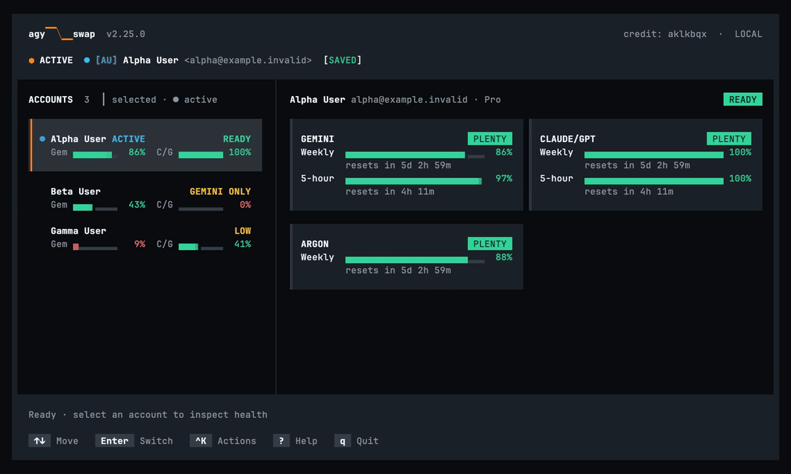

# agy-swap (한국어)

브라우저에서 로그아웃하지 않고 터미널에서 Google Antigravity 계정을 전환합니다.

Gemini, Claude/GPT, Gemini 4 Argon의 5시간 및 주간 할당량을 확인한 뒤 `Enter`를 눌러 `agy` CLI와 Antigravity IDE를 함께 전환할 수 있습니다(macOS 및 Linux 지원, Windows는 CLI만 전환).

[English](../../README.md) · [ไทย](README.th.md) · [日本語](README.ja.md) · [简体中文](README.zh-CN.md) · **한국어** · [한국어 웹사이트](https://agy-swap.aklkbqx.com/ko/) · [가이드 (영어)](https://agy-swap.aklkbqx.com/guides/)



## 주요 기능

- 브라우저 재인증 없이 `agy` CLI와 (macOS 및 Linux의) Antigravity IDE 및 Jetski 세션을 한 번에 전환합니다.
- `Gemini`, `Claude/GPT`, Pro 주간 `Gemini 4 Argon` 풀의 남은 할당량과 로컬 리셋 시각, `READY` / `LOW` / `GEMINI ONLY` / `CLAUDE/GPT ONLY` / `LIMITED` / `VERIFY` 상태를 표시합니다.
- 다른 폴더에서 실행 중인 `agy`의 백그라운드 토큰 갱신이 현재 활성 계정을 덮어쓰지 않도록 보호합니다(`--sync-session`).
- 스크립트 전환(`next --family claude`), 수동 대기 시간(`limit`), 디렉터리 바인딩(`profile` / `bind`), Starship·tmux·zsh용 `statusline`, AES-GCM 암호화 `backup`, SHA-512 검증 `install-agy`를 지원합니다.

## 설치 방법

```bash
# Homebrew (macOS / Linux)
brew install aklkbqx/agy-swap/agy-swap

# Shell (macOS / Linux, SHA-256 검증)
curl -fsSL --proto '=https' --tlsv1.2 https://agy-swap.aklkbqx.com/install.sh | bash
```

```powershell
# Windows PowerShell (SHA-256 검증)
irm https://agy-swap.aklkbqx.com/install.ps1 | iex
```

```bash
# 소스에서 설치 (Go 1.27.4+)
go install github.com/aklkbqx/agy-swap/v2/cmd/agy-swap@latest
```

사내 TLS 프록시 및 미러 설정은 [한국어 설치 안내](https://agy-swap.aklkbqx.com/ko/install.html)와 [docs/reference.md](../reference.md#install-and-restricted-networks)를 참고하세요.

## 처음 실행하기

```bash
agy-swap install-agy   # 공식 agy CLI가 없을 때 설치
agy-swap add           # Google 로그인 후 계정 저장
agy-swap               # TUI를 열고 계정을 고른 뒤 Enter -> Switch 선택
```

## 자주 쓰는 명령어

```bash
agy-swap list                          # 저장된 계정 상태 및 할당량 목록 확인
agy-swap switch 2                      # 이메일, 별칭 또는 번호로 계정 전환
agy-swap next --family claude          # 할당량 갱신 후 여유 있는 다음 계정으로 전환
agy-swap limits --refresh              # 5시간, 주간 및 Argon 할당량 세부 창 확인
agy-swap limit set 1 6h --group claude # 특정 계정에 수동 대기 시간 설정 또는 해제
agy-swap verify dev@company.com        # VERIFY 상태 계정의 Google 인증 페이지 열기 (TUI는 w 키)
agy-swap statusline install            # Starship, tmux, zsh 프롬프트에 상태줄 추가
agy-swap doctor                        # 로컬 파일, 인증 정보 및 프록시 연결 상태 점검
```


macOS 또는 Linux에서 두 개의 `agy` CLI 터미널을 서로 다른 Google 계정으로 동시에 실행하려면 별도의 `HOME` 디렉터리, `antigravity-keyring-unavailable` 파일, `AGY_SWAP_SKIP_SYNC=1 WSL_INTEROP=1` 설정을 사용합니다. 자세한 명령은 [docs/reference.md](../reference.md#run-two-agy-cli-sessions-on-different-accounts-at-once)에서 확인할 수 있습니다.

## 보안 및 토큰 저장

- `agy-swap`은 공식 `agy` CLI와 Antigravity IDE를 위한 로컬 세션 전환 도구이며 서드파티 API 라우터나 OAuth 프록시가 아닙니다. 프롬프트와 모델 추론은 `agy-swap`을 거치지 않고 공식 클라이언트에서 직접 처리됩니다.
- Google 자체의 다중 계정 및 결제 정책은 그대로 적용되므로 한도 우회 목적의 다중 계정 사용 시 위험이 전혀 없다고 보장할 수 없습니다.
- 저장된 계정 토큰은 본인만 읽을 수 있는 `vault.json`(권한 `0600`, 암호화되지 않음)에 저장되며, macOS Keychain, Windows 자격 증명 관리자 또는 Linux Secret Service를 사용하려면 `AGY_SWAP_VAULT=keychain`을 설정하세요.
- `agy-swap`은 로컬에서만 동작하며 사용 텔레메트리나 충돌 보고를 전송하지 않습니다. 대화형 TUI 및 네트워크 명령 실행 시에만 캐시된 일일 버전 확인(`GET https://agy-swap.aklkbqx.com/version.json`, 버전·OS·아키텍처·설치 경로만 전송)을 수행하며, `AGY_SWAP_NO_UPDATE_CHECK=1` 또는 `DO_NOT_TRACK=1`로 끌 수 있습니다.

자세한 내용은 [SECURITY.md](../../SECURITY.md)와 [docs/reference.md](../reference.md)에 정리되어 있습니다.
