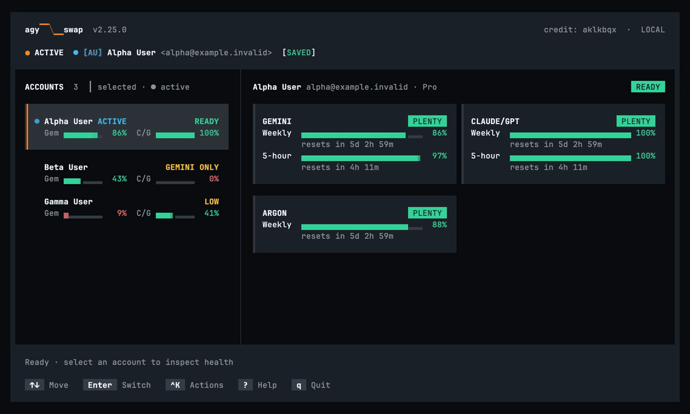

# agy-swap (ภาษาไทย)

สลับบัญชี Google Antigravity จากเทอร์มินัลโดยไม่ต้องออกจากระบบในเบราว์เซอร์

ดูโควตารอบ 5 ชั่วโมงและรายสัปดาห์ของ Gemini, Claude/GPT และ Gemini 4 Argon แล้วกด `Enter` เพื่อสลับทั้ง `agy` CLI และ Antigravity IDE (บน macOS และ Linux ส่วน Windows สลับเฉพาะ CLI)

[English](../../README.md) · **ไทย** · [日本語](README.ja.md) · [简体中文](README.zh-CN.md) · [한국어](README.ko.md) · [เว็บไซต์ภาษาไทย](https://agy-swap.aklkbqx.com/th/) · [คู่มือ (EN)](https://agy-swap.aklkbqx.com/guides/)



## ทำอะไรได้บ้าง

- สลับทั้ง `agy` CLI และ Antigravity IDE รวมถึง Jetski (บน macOS และ Linux) ในคราวเดียวโดยไม่ต้องเข้าเบราว์เซอร์ใหม่
- แสดงโควตารอบ 5 ชั่วโมงและรายสัปดาห์ของ `Gemini`, `Claude/GPT` และ `Gemini 4 Argon` พร้อมเวลารีเซ็ตตามเครื่องและป้าย `READY`, `LOW`, `GEMINI ONLY`, `CLAUDE/GPT ONLY`, `LIMITED`, `VERIFY`
- Session guard (`--sync-session`) เก็บโทเคนที่ `agy` รีเฟรชเบื้องหลังกลับเข้า vault ตามบัญชีเดิมโดยไม่ทับบัญชีที่กำลังใช้งานอยู่
- รองรับการหมุนบัญชีในสคริปต์ (`next --family claude`), ตั้งพักชั่วคราว (`limit`), ผูกโฟลเดอร์ (`profile` / `bind`), `statusline` บน Starship/tmux/zsh, สำรองข้อมูลเข้ารหัส AES-GCM และติดตั้ง `agy` ทางการ (`install-agy`) พร้อมตรวจ SHA-512

## การติดตั้ง

```bash
# Homebrew (macOS และ Linux)
brew install aklkbqx/agy-swap/agy-swap

# Shell (macOS และ Linux ตรวจเช็กซัม SHA-256)
curl -fsSL --proto '=https' --tlsv1.2 https://agy-swap.aklkbqx.com/install.sh | bash
```

```powershell
# Windows PowerShell (ตรวจเช็กซัม SHA-256)
irm https://agy-swap.aklkbqx.com/install.ps1 | iex
```

```bash
# ติดตั้งจากซอร์สโค้ด (Go 1.27.4+)
go install github.com/aklkbqx/agy-swap/v2/cmd/agy-swap@latest
```

ดูวิธีติดตั้งหลังพร็อกซีองค์กรได้ที่ [คู่มือติดตั้งภาษาไทย](https://agy-swap.aklkbqx.com/th/install.html) และ [docs/reference.md](../reference.md#install-and-restricted-networks)

## เริ่มต้นใช้งาน

```bash
agy-swap install-agy   # ติดตั้ง Google Antigravity CLI หากยังไม่มี
agy-swap add           # เข้าสู่ระบบ Google และบันทึกบัญชี
agy-swap               # เปิด TUI เลือกบัญชี กด Enter แล้วเลือก Switch
```

## คำสั่งที่ใช้บ่อย

```bash
agy-swap list                          # แสดงบัญชี สถานะ และแถบโควตา
agy-swap switch 2                      # สลับบัญชีด้วยอีเมล ชื่อเล่น หรือเลขลำดับ
agy-swap next --family claude          # รีเฟรชและสลับไปบัญชีถัดไปที่ยังมีโควตา Claude/GPT
agy-swap limits --refresh              # ดูหน้าต่างโควตา 5 ชั่วโมง รายสัปดาห์ และ Argon
agy-swap limit set 1 6h --group claude # ตั้งหรือล้างเวลาพักบัญชีด้วยตนเอง
agy-swap verify dev@company.com        # เปิดหน้ายืนยัน Google เมื่อบัญชีขึ้น VERIFY (หรือกด w ใน TUI)
agy-swap statusline install            # แสดงโควตาบนพรอมต์ Starship, tmux หรือ zsh
agy-swap doctor                        # ตรวจไฟล์ระบบ ข้อมูลเข้าสู่ระบบ และพร็อกซี
```


หากต้องการรัน `agy` CLI สองหน้าต่างคนละบัญชีพร้อมกันบน macOS หรือ Linux ให้แยกโฟลเดอร์ `HOME` พร้อมไฟล์ `antigravity-keyring-unavailable` และกำหนด `AGY_SWAP_SKIP_SYNC=1 WSL_INTEROP=1` ตามรายละเอียดใน [docs/reference.md](../reference.md#run-two-agy-cli-sessions-on-different-accounts-at-once)

## ความปลอดภัยและการเก็บโทเคน

- `agy-swap` เป็นตัวสลับไฟล์เซสชันในเครื่องสำหรับ `agy` CLI และ Antigravity IDE ตัวทางการ ไม่ใช่ API router หรือ OAuth proxy จากภายนอก ดังนั้น prompt และการประมวลผลโมเดลจะไม่วิ่งผ่าน `agy-swap`
- กฎเรื่องการมีหลายบัญชีและการชำระเงินของ Google เองยังมีผลอยู่ จึงไม่สามารถรับปากว่าจะไม่มีความเสี่ยงต่อบัญชีหากใช้หลายบัญชีเพื่อเลี่ยงข้อจำกัดแพ็กเกจ
- โทเคนที่บันทึกไว้เก็บอยู่ในไฟล์ `vault.json` (สิทธิ์ `0600` และไม่ได้เข้ารหัส) ซึ่งอ่านได้เฉพาะผู้ใช้ของคุณ หรือกำหนด `AGY_SWAP_VAULT=keychain` เพื่อเก็บใน macOS Keychain, Windows Credential Manager หรือ Linux Secret Service แทน
- `agy-swap` ทำงานในเครื่องและไม่มีการส่ง telemetry หรือข้อมูลการใช้งาน มีเพียงการเช็กเวอร์ชันล่าสุดวันละ 1 ครั้งแบบแคชเฉพาะคำสั่งที่ใช้งานต่อเนื่องหรือเครือข่าย (ส่งเฉพาะเลขเวอร์ชัน ระบบปฏิบัติการ สถาปัตยกรรม และช่องทางติดตั้ง ไม่ส่งบัญชีหรือรหัสเครื่อง) ซึ่งปิดได้ด้วย `AGY_SWAP_NO_UPDATE_CHECK=1` หรือ `DO_NOT_TRACK=1`

ดูรายละเอียดทั้งหมดใน [SECURITY.md](../../SECURITY.md) และ [docs/reference.md](../reference.md)
