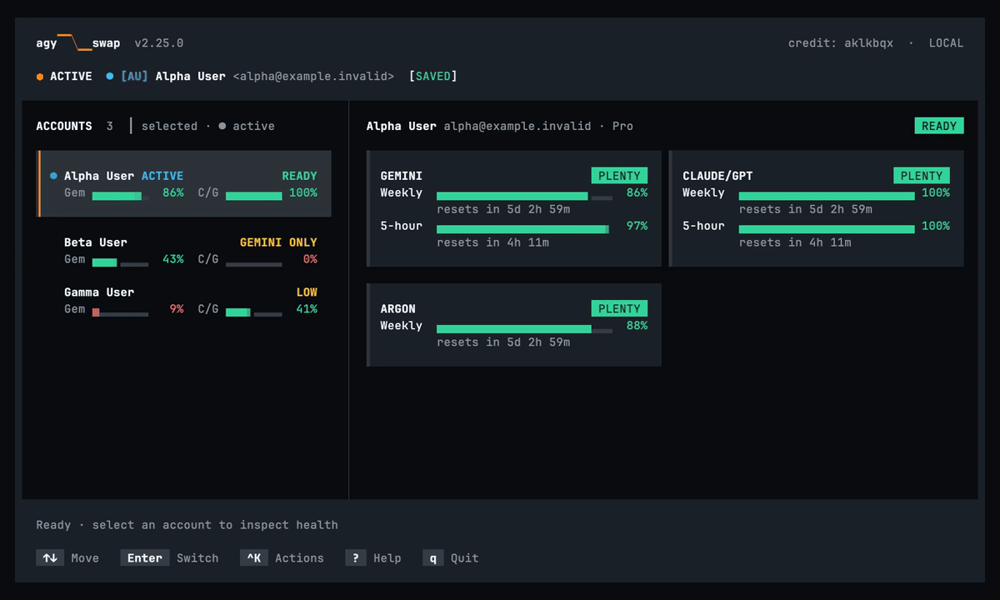

# agy-swap (简体中文)

在终端直接切换 Google Antigravity 账号，无需打开浏览器退出再登录。

实时查看 Gemini、Claude/GPT 与 Gemini 4 Argon 的 5 小时和每周配额，按 `Enter` 即可同步切换 `agy` CLI 与 Antigravity IDE（支持 macOS 和 Linux；Windows 仅切换 CLI）。

[English](../../README.md) · [ไทย](README.th.md) · [日本語](README.ja.md) · **简体中文** · [한국어](README.ko.md) · [中文主页](https://agy-swap.aklkbqx.com/zh/) · [专题指南 (英文)](https://agy-swap.aklkbqx.com/guides/)



## 核心能力

- 一次切换即可更新 `agy` CLI 与（macOS 和 Linux 上的）Antigravity IDE 及 Jetski 会话，无需打开浏览器。
- 实时显示 `Gemini`、`Claude/GPT` 与 Pro 每周 `Gemini 4 Argon` 配额池的剩余容量、本地重置时间以及 `READY` / `LOW` / `GEMINI ONLY` / `CLAUDE/GPT ONLY` / `LIMITED` / `VERIFY` 标签。
- 会话守卫（`--sync-session`）可回收其他终端后台刷新的令牌回对应的 vault 记录，防止覆盖当前活跃账号。
- 支持脚本轮换（`next --family claude`）、冷却期控制（`limit`）、目录绑定（`profile` / `bind`）、Starship/tmux/zsh `statusline`、AES-GCM 加密 `backup` 以及校验 SHA-512 的 `install-agy`。

## 安装方式

```bash
# Homebrew (macOS / Linux)
brew install aklkbqx/agy-swap/agy-swap

# Shell (macOS / Linux，校验 SHA-256)
curl -fsSL --proto '=https' --tlsv1.2 https://agy-swap.aklkbqx.com/install.sh | bash
```

```powershell
# Windows PowerShell (校验 SHA-256)
irm https://agy-swap.aklkbqx.com/install.ps1 | iex
```

```bash
# 从源码安装 (Go 1.27.4+)
go install github.com/aklkbqx/agy-swap/v2/cmd/agy-swap@latest
```

企业 TLS 检查代理与内部镜像配置见 [中文安装指南](https://agy-swap.aklkbqx.com/zh/install.html) 和 [docs/reference.md](../reference.md#install-and-restricted-networks)。

## 快速上手

```bash
agy-swap install-agy   # 可选：安装官方 agy CLI
agy-swap add           # 通过浏览器登录并保存 Google 账号
agy-swap               # 打开终端界面，选中账号后按 Enter -> Switch
```

## 常用命令

```bash
agy-swap list                          # 查看已保存账号的状态和配额
agy-swap switch 2                      # 按邮箱、别名或序号切换账号
agy-swap next --family claude          # 刷新配额并轮换到下一个可用账号
agy-swap limits --refresh              # 查看 5 小时、每周与 Argon 配额窗口
agy-swap limit set 1 6h --group claude # 设置或清除手动冷却时间
agy-swap verify dev@company.com        # 打开 Google 账号验证页面 (TUI 中按 w)
agy-swap statusline install            # 为 Starship、tmux 或 zsh 配置状态栏
agy-swap doctor                        # 检查本地存储、凭证状态与网络连通性
```


如果需要在 macOS 或 Linux 上同时运行两个使用不同 Google 账号的 `agy` CLI 终端，请为第二个终端设置独立的 `HOME`、`antigravity-keyring-unavailable` 标记以及 `AGY_SWAP_SKIP_SYNC=1 WSL_INTEROP=1`，完整步骤见 [docs/reference.md](../reference.md#run-two-agy-cli-sessions-on-different-accounts-at-once)。

## 安全与凭证存储

- `agy-swap` 是面向官方 `agy` CLI 与 Antigravity IDE 的本地会话切换工具，不是第三方 API 路由或 OAuth 代理。提示词和模型推理从不经过 `agy-swap`，所有请求仍由官方客户端直接发出。
- Google 自身的多账号与计费规则仍然适用，因此无法承诺在多账号绕过限额时零风险。
- 已保存的账号令牌默认存储在仅当前用户可读的 `vault.json` 文件（权限 `0600`，未加密）中；设置 `AGY_SWAP_VAULT=keychain` 可改为保存到 macOS Keychain、Windows 凭据管理器或 Linux Secret Service。
- `agy-swap` 完全在本地运行，不发送任何使用遥测或崩溃报告。仅在交互界面及联网命令期间每 24 小时执行一次带缓存的新版本检查（`GET https://agy-swap.aklkbqx.com/version.json`，仅发送版本号、系统、架构和安装渠道），可通过 `AGY_SWAP_NO_UPDATE_CHECK=1` 或 `DO_NOT_TRACK=1` 关闭。

详细说明见 [SECURITY.md](../../SECURITY.md) 与 [docs/reference.md](../reference.md)。
