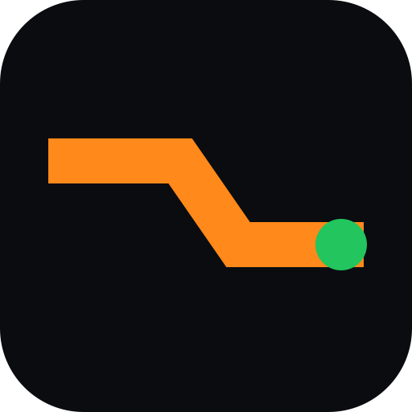

# agy-swap

agy-swap helps an operator inspect several Google Antigravity accounts, choose an eligible account and switch the shared local session. The Tool is a Go CLI/TUI; the companion Site explains installation and demonstrates the native renderer through committed story frames.

The logo is the existing project brand image, copied byte-for-byte from the public Site favicon. It is an actual repository image, so this page renders without an external image service.

## Start here

| Need | Canonical reference |
| --- | --- |
| Install, first run, command examples | [README](../../README.md) and [public install page](https://agy-swap.aklkbqx.com/install.html) |
| Account selection and manual override | [How selection works](../../README.md#how-account-selection-works) |
| Saved tokens, active-session backend, network and security support | [Security policy](../../SECURITY.md), [architecture](../architecture.md) |
| Local testing, demo and release tooling | [Development guide](../development.md) |
| Working across repositories | [GitHub workflow](../github-workflow.md) |
| What each version delivered | [All-version index](../releases/README.md), [changelog](../../CHANGELOG.md), original GitHub Releases |
| Current work and decisions | [Tool Issues](https://github.com/aklkbqx/agy-swap/issues), [knowledge map](knowledge-map.md), [decisions](../decisions/README.md) |

## Operating boundaries

Saved credentials stay local. The default saved-account vault is permission-restricted `vault.json`, not encryption at rest. Explicit keychain mode selects the OS store for saved credentials; active Antigravity session writes use the platform-compatible session backend. Read the security policy before exporting credentials or changing storage.

Automatic account selection needs a sufficiently fresh, eligible quota snapshot and refreshes before applying a selection. A manual `switch` is an explicit override. Doctor may create/recover local state and is not strictly read-only.

The public Site is static content served by one Nginx container. AGY Live and its PTY/WebSocket gateway are opt-in local development tools. Production does not expose `/demo/ws`. Product hosting remains self-hosted; GitHub stores project knowledge, tasks and release assets.

Historical documentation covers all known versions. Security fixes cover only latest stable. Missing historical evidence stays unknown; the open Windows reporter follow-up remains [Issue #4](https://github.com/aklkbqx/agy-swap/issues/4).
